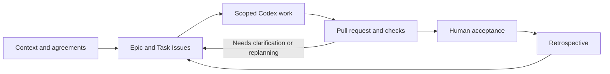

<p align="center">
  
</p>

<h1 align="center">Agentic Development Kit for Codex</h1>

<p align="center">
  <strong>GitHub-native, Human-on-the-Loop workflows for development with Codex.</strong>
</p>

<p align="center">
  <a href="https://github.com/mochan-tk/agentic-dev-kit-for-codex/actions/workflows/ci.yml"></a>
  <a href="LICENSE"></a>
</p>

<p align="center">
  <a href="#quick-start">Quick start</a> ·
  <a href="#prerequisites">Prerequisites</a> ·
  <a href="#how-it-works">How it works</a> ·
  <a href="#eight-skills-one-workflow">Skills</a> ·
  <a href="#safety-and-project-status">Safety and status</a> ·
  <a href="#documentation">Documentation</a>
</p>

Give Codex a repeatable way to prepare context, plan, implement, and return
evidence. Keep plans and decisions in GitHub instead of relying on one chat.

Codex works within a defined Task. Humans set direction, decide exceptions,
and retain agreement, acceptance, and merge authority. The kit's Skills,
instructions, templates, and helpers support this workflow without replacing
your application, development tools, or delivery process.

Adapted from [Agentic Development Kit for GitHub Copilot](https://github.com/mochan-tk/agentic-dev-kit-for-copilot).
This edition uses Codex Skill and role files without assuming the Copilot app's
native session hierarchy or a complete autonomous runtime.

## Quick start

### Prerequisites

Prerequisites are cumulative; the IDs below bind this table to the
machine-readable [prerequisite registry](.github/distribution/prerequisites.v1.json).

| Tier | Prerequisites added at this tier | Reach |
|---|---|---|
| Tier 0 — Install & inspect | GitHub repository and local checkout (`github-checkout`); Git (`git`); Bash 3.2+, with [Git for Windows](https://gitforwindows.org/) / Git Bash on Windows (`bash`); `jq` (`jq`); [`gh`](https://cli.github.com/) (`gh`), authenticated with access to the target repository (`repository-access`) | Install/stage the scaffold and read its documentation. |
| Tier 1 — Onboard & run Tasks | **[ChatGPT Codex desktop app](https://learn.chatgpt.com/docs/app)** (`codex-desktop`); prepared specification context (`spec-context`); adopter Codex project (`codex-project`); scaffold landed on the remote default branch before onboarding (`remote-scaffold`) | Complete onboarding and run authorized Tasks locally. |
| Tier 2 — Full operation | Projects `read:project` / `project` permissions (`projects-scope`); a board or a recorded scoped exception for environmental inability or explicit owner decline (`projects-board-or-exception`) | Operate the roadmap and perform required Task close-out. |

**Tier 1: the desktop app is required for this OSS, not just for this tutorial.**
Use the desktop app for onboarding, coordination and development; Codex CLI
or the IDE extension alone is unsupported. Terminal installers and helpers
neither replace this requirement nor check whether the app is installed.

For full adoption, prepare specification context and create/select the adopter's
Codex project below. Tier 0 installation/inspection can precede Tier 1 readiness
but does not complete onboarding. See [step 1](#1-install-in-your-project) for platform-specific installation utilities.

**Tier 2:** the GitHub Projects roadmap is **required by default**, with durable scoped
exceptions when the environment cannot create/use it or the owner explicitly
declines Projects. It needs Projects access: `read:project`
for queries and `project` for creation/updates with classic/OAuth credentials
([GitHub's scope guidance](https://docs.github.com/en/issues/planning-and-tracking-with-projects/automating-your-project/using-the-api-to-manage-projects)).
Repository access alone is insufficient. If scopes are missing, the owner can
run `gh auth refresh -s project` for stored `gh` credentials; environment tokens
or other credential types may need their own permission update. The kit reports
the gap early and asks separately before creating a board. It never refreshes
credentials automatically. Record a declined/unavailable exception on the
relevant Epic/Tasks; Issue-based planning and development can continue.
Creation and date application need their applicable authorization. A pending
answer or a date-only defer/decline is not a Project exception: otherwise
authorized work may proceed, but required close-out stays pending. Before a
Task is reported complete, verify Kind `Task` and both authorized dates on its
exact Project item, or cite its exception. See the
[close-out procedure](.github/distribution/payload/.agents/skills/plan-management/SKILL.md#required-per-task-project-close-out).

For a one-command read-only diagnosis, use Python 3.11+ and a reviewed kit
source checkout; these diagnostics are not installed payload:

```sh
python3 -I /path/to/reviewed-kit/.github/scripts/check-prerequisites.py /path/to/adopter
```

The target defaults to the current directory. Missing prerequisites name their
impact and remedy; desktop/context/project state needs explicit procedural
confirmation. Diagnostics do not install, authenticate, grant consent or block
onboarding. The [introduction guide](docs/introduction.md) covers exit statuses,
the seven-point material check and onboarding evidence PR lead-time records.
The checkout is only for diagnostics; adoption uses the public installer.

### Before you start: prepare context and a Codex project

Use the required desktop app with your local application repository. If it has
a product selector, select **Codex**, not ChatGPT Chat or Work, for installation
and development.

1. **Prepare specification context before using the kit.** Use ChatGPT
   **Chat** to clarify requirements interactively, or **Work** to assemble a
   reviewable specification from notes and sources. Record the goal, intended
   users, scope/non-goals, constraints, acceptance criteria, and unresolved
   questions. Review it and reuse suitable existing specifications. Prepare
   this handoff before adoption; the installer does not validate its contents
   and no external connector is required.
2. **First in Codex, create or select your project.** Attach your application's
   local Git repository and make its root the project's primary folder. This
   **adopter repository** is not the kit's source checkout. Prepare or clone it
   first if needed; an app project does not replace Git setup. Start a local
   chat in that project and confirm its working directory before step 1 below.
3. **Bring the prepared context with you.** Save it in a readable file, attach
   it, or paste relevant text when the onboarding Skill asks for material.
   Give paths for documents already committed in the adopter repository.
   Do not assume Chat/Work history, a ChatGPT project, or a chat link automatically
   supplies context to Codex. Share only authorized material; drafts become
   approved agreements only through the kit's human review process.

A Codex project selects the execution context. It is not a ChatGPT preparation
project or a GitHub Projects board. See the [detailed preparation checklist](docs/distribution/source-first-installer.md#prepare-context-and-the-desktop-project)
and official guidance on [desktop mode selection](https://learn.chatgpt.com/docs/app),
[local project folders](https://learn.chatgpt.com/docs/projects#use-local-projects-for-folders-and-codebases),
and [Chat versus Work](https://learn.chatgpt.com/docs/use-chatgpt#choose-how-you-want-to-work).

### 1. Install in your project

Run the **public one-command installer** below in a terminal at the adopter
root selected in your Codex desktop project: an **existing Git repository**
that no other agent or person is changing concurrently. To adopt the kit,
use this route; do not clone it or run installer scripts from a kit checkout.

| Installation route | Additional utilities |
|---|---|
| macOS / Linux installation | curl, find, standard Unix utilities (including GNU/BSD `stat`), and `sha256sum` or `shasum` |
| Windows installation | PowerShell and the Unix utilities supplied by Git for Windows / Git Bash |

**macOS / Linux**

```sh
curl -fsSL https://raw.githubusercontent.com/mochan-tk/agentic-dev-kit-for-codex/main/.github/scripts/scaffold-init.sh | bash
```

**Windows PowerShell**

```powershell
irm https://raw.githubusercontent.com/mochan-tk/agentic-dev-kit-for-codex/main/.github/scripts/scaffold-init.ps1 | iex
```

Downloading the public kit needs no GitHub login; operating it still requires
the authenticated `gh` and other workflow prerequisites above. The Windows
entry uses Git Bash, not WSL; it has synthetic-test coverage, but native Windows
installation has not been measured.

The installer resolves a source revision, validates and installs the payload,
and stages only newly installed files. It preserves project-owned files and
refuses conflicting engine files or unsafe paths. It does **not** create a Git
repository, commit, push, configure GitHub, or start onboarding.

To preview without changing project files or the Git index:

```sh
curl -fsSL https://raw.githubusercontent.com/mochan-tk/agentic-dev-kit-for-codex/main/.github/scripts/scaffold-init.sh | bash -s -- --dry-run
```

These commands execute downloaded code. Review the source before trusting it.
For a fixed revision, caller-side `pipefail` to detect initial download failure,
or PowerShell flags, see the
[installation guide](docs/distribution/source-first-installer.md#one-command-first-installation).
If copying or staging fails, stop and review the reported partial state; do
not assume the installer has rolled it back.

### 2. Review and land the installation

Inspect the staged changes:

```sh
git diff --cached
```

Other changes may already be staged. Commit only reviewed adoption changes
and land them on the remote default branch through your normal approval
process before onboarding makes GitHub changes.

Keep your project's existing README, AGENTS, CI, and other customizations.
If an existing `AGENTS.md` was preserved, explicitly connect the installed
`.github/codex-instructions.md` and Skills as described in the
[installed workflow guide](.github/distribution/payload/README.md).
Follow this public Quick start for installation and staging: the entry stages
new files. The preserved guide's no-staging statement describes the internal
engine, not the public installer.

### 3. Onboard in Codex

Before invoking the Skill, open or select the adopter checkout in Codex—
**your project**, not the kit's repository—and start a new local desktop chat
in the prepared project to read the installed files. Have your specification
context ready for the material question. Answer every pending question,
including model preference, explicitly (`auto` is a choice, not a timeout default).

In the desktop project chat, invoke the installed Skill:

```text
$project-onboarding
```

If your desktop app version lacks that invocation, use this explicit
installed-file fallback in the same chat:

```text
Read and follow .agents/skills/project-onboarding/SKILL.md in this project.
```

Confirm it reads the installed file, not the kit-development Skill. This is
an explicit handoff, not a guarantee of automatic discovery in every app version.

Onboarding inventories the project, verifies existing commands, tunes its
instructions, and prepares an evidence-bearing onboarding PR and planning
handoff. It does not implement your application's next feature. Review the PR,
resolve or record deferred work, and accept onboarding before ordinary development.

After the reviewed installation reaches the remote default branch, onboarding
runs canonical label setup and drafts phase Epic Issues for review when you
supply a goal or material. These writes are distinct from optional Ruleset
setup: explicitly choose Enable now, Create disabled, or Skip. Writes require
a reviewed profile and separate consent; Skip performs no Ruleset operation.
The installer itself creates neither CI workflows nor branch protection. See the [onboarding Skill](.github/distribution/payload/.agents/skills/project-onboarding/SKILL.md).

To connect Task records to PR checks, a separate [opt-in adopter CI companion](docs/distribution/adopter-ci.md)
previews three addon files for explicitly named application checks. It requires
a supported existing workflow, preserves application CI and the Git index,
and adds no required-check settings. Accept its installation before separately
considering check activation; it is outside the legacy 47-file update path.

### 4. Complete one small Task

For an existing codebase, start with characterization tests for the area you
intend to change. This onboarding Skill legacy path establishes an
observed-behavior baseline before feature work. For example:

```text
Use the installed kit workflow to add characterization tests for the existing
report page. Capture its current behavior without adding a feature or changing
application behavior.

Inspect the code first. Propose the acceptance criteria, owned files,
verification commands, and Task plan. Ask me to resolve unclear requirements.
After the plan is agreed, implement and test the change, then open a PR
with the results and any remaining concerns. Leave the merge decision to me.
```

The [illustrative worked example](docs/worked-example.md) covers a first
characterization Task with locally runnable reference tests. It is neither
accepted live work nor installed into your project.

Review the Task, diff, and evidence—not only the final chat message—then accept,
redirect, or reject. Use retrospectives when repeated friction suggests a
reusable improvement. After accepting the characterization baseline, plan a
small feature Task separately. For a new codebase, agree on initial behavior
and tests in its first bounded Task.

### 5. Update explicitly when you choose

No kit clone is needed. Supply full 40-character commit IDs for the installed
version (`FROM`) and reviewed new version (`TO`). Use the previous installation's
recorded `source-commit` or accepted adoption record for `FROM`; if unknown,
inspect that record before updating. Choose a **new recovery directory outside your project**
with an existing parent. Run from your project root with exclusive ownership
during the update.

```sh
FROM=FULL_OLD_COMMIT_SHA
TO=FULL_NEW_COMMIT_SHA
RECOVERY=/path/to/new-private-recovery
set -o pipefail
curl -fsSL https://raw.githubusercontent.com/mochan-tk/agentic-dev-kit-for-codex/main/.github/scripts/scaffold-update.sh | bash -s -- --from "$FROM" --to "$TO" --recovery "$RECOVERY"
```

The default previews without changing project files, the index, or the
requested recovery directory. Apply the explicit update with:

```sh
curl -fsSL https://raw.githubusercontent.com/mochan-tk/agentic-dev-kit-for-codex/main/.github/scripts/scaffold-update.sh | bash -s -- --from "$FROM" --to "$TO" --recovery "$RECOVERY" --apply
```

PowerShell with Git Bash uses the same inputs and default preview:

```powershell
$From = 'FULL_OLD_COMMIT_SHA'
$To = 'FULL_NEW_COMMIT_SHA'
$Recovery = 'D:\private-recovery\new-update'
& ([scriptblock]::Create((irm https://raw.githubusercontent.com/mochan-tk/agentic-dev-kit-for-codex/main/.github/scripts/scaffold-update.ps1))) --from $From --to $To --recovery $Recovery
& ([scriptblock]::Create((irm https://raw.githubusercontent.com/mochan-tk/agentic-dev-kit-for-codex/main/.github/scripts/scaffold-update.ps1))) --from $From --to $To --recovery $Recovery --apply
```

Known-old engine files update; tuned instructions, instance records, existing
seed files and unrelated work are preserved. Unknown engine edits refuse the
whole update. Nothing is staged, committed or pushed. Keep the private recovery
directory at its original location, including after a failed apply. See
[offline rollback and fixed-entry selection](docs/distribution/source-first-installer.md#one-command-explicit-update)
before changing or deleting retained recovery inputs. Native Windows remains
unmeasured; updates are explicit and do not detect installed versions.

### 6. Check the project without cloning the kit

The [fixed-revision companion commands](docs/distribution/companion-checks.md)
observe GitHub governance, check planned worktree actions, or validate connector
definitions. Choose a check and supply actual inputs; each Bash command downloads
the complete unchanged helper, verifies its recorded SHA-256, and runs it
without installing extra project files.

Governance uses your existing authenticated `gh` for GET-only observations;
the other checks are local after downloading. No command repairs settings,
claims ownership, activates connectors or grants permission to push. Missing
evidence remains non-success. A successful check is not runtime qualification.

## How it works

GitHub is the durable work record. Codex sessions execute work without replacing
the Issue graph or human acceptance.



This diagram describes the workflow, not a guaranteed native session tree.
Use the tools actually available in the required Codex desktop app, or an explicit
handoff based on the committed files and GitHub records.

| Responsibility | Focus |
|---|---|
| Human owner | Intent, priorities, risk decisions, agreements, acceptance, and merge |
| Project / Epic coordination | The Issue graph, dependencies, next actionable Tasks, and replanning |
| Task supervision | Scope, plan, one active writer, verification, and escalation |
| Implementation worker | One scoped change, tests, commits, and evidence for a pull request |

The three shipped role definitions are instructions, not authenticated identities
or guaranteed native role selection. A GitHub Projects board is required by
default with the two recorded exceptions above; the Issue graph remains
authoritative. A board match is verification evidence, not acceptance or merge authority.

### Human-on-the-Loop by design

Routine, scoped work can follow the agreed plan without per-edit human approval.
Ambiguity, high risk, scope changes, and insufficient evidence need human
judgment. The owner retains agreement and merge authority.

Record decisions before reporting them, verify before claiming completion,
keep one writer per owned scope, and escalate rather than guess. Planned
handoffs preserve the current Task, plan, and committed checkpoint;
they are not automatic crash recovery.

## Eight Skills, one workflow

These links show the **payload installed in your project**. Contributor
instructions for this kit are in [AGENTS.md](AGENTS.md).

| Skill | Use it to |
|---|---|
| [project-onboarding](.github/distribution/payload/.agents/skills/project-onboarding/SKILL.md) | Discover the project, verify its commands, and prepare its onboarding PR |
| [context-collection](.github/distribution/payload/.agents/skills/context-collection/SKILL.md) | Collect source material with provenance, or explicitly start builtin drafting |
| [context-distillation](.github/distribution/payload/.agents/skills/context-distillation/SKILL.md) | Propose durable requirements and decisions for human review |
| [plan-management](.github/distribution/payload/.agents/skills/plan-management/SKILL.md) | Build Epic / Task Issues and identify actionable work |
| [task-routing](.github/distribution/payload/.agents/skills/task-routing/SKILL.md) | Choose a suitable execution path for the bounded Task |
| [session-orchestration](.github/distribution/payload/.agents/skills/session-orchestration/SKILL.md) | Coordinate supervision, implementation, replanning, and handoffs |
| [verification](.github/distribution/payload/.agents/skills/verification/SKILL.md) | Check the diff, test results, and current records against acceptance criteria |
| [retro](.github/distribution/payload/.agents/skills/retro/SKILL.md) | Turn supported recurring problems into reviewed improvement proposals |

Use the current step's Skill; do not restart onboarding for each Task. Collected
material and draft requirements are not automatically accepted project truth;
distillation and review are separate decisions.

## Safety and project status

The kit is a workflow scaffold with explicit evidence and human gates—not an
autonomous service or a guarantee that generated code is correct.

| Boundary | What to expect |
|---|---|
| Existing project assets | Installation preserves project-owned content and stops on unsafe conflicts |
| Updates and recovery | Explicit old/new commit IDs support a one-command update with preserved customizations and retained offline operation rollback; no automatic or whole-repository recovery |
| Governance helpers | Reads report missing evidence as non-success; setup writes require separate, explicit authority |
| Feedback and retro | Reporting is consent-gated; retrospective proposals do not approve or retire controls automatically |
| Codex compatibility | The ChatGPT Codex desktop app is required; CLI-only/IDE-only operation is unsupported. Evidence remains version/path-specific; automatic Skill discovery and cross-client parity are not promised |
| Product and release | A source-first workflow kit with bounded product tests; native Windows and cross-client runtime parity remain unmeasured |

Run the explicit governance, worktree and connector companions from a reviewed
kit checkout or the [verified no-clone commands](docs/distribution/companion-checks.md);
the one-command entry does not install them. The consent-gated failure reporter
also has a [verified no-clone draft/send guide](docs/distribution/feedback.md).
For manual text, use the [public feedback form](https://github.com/mochan-tk/agentic-dev-kit-for-codex/issues/new?template=feedback.yml)
and review its privacy warning before submitting. Installation failures print
fixed links to these routes; reporting is a separate explicit action. See the
[helper and procedure guide](docs/distribution/source-first-installer.md#governance-worktree-and-retro-procedures).

This repository's clean product Git history preserves the accepted predecessor's
47-file payload and installer engine. [product scope](docs/product-scope.md) and
[known limitations](docs/known-limitations.md) describe current behavior and evidence boundaries.
Earlier acceptance, research and unfinished runtime/release work remain in the
[predecessor records](docs/provenance.md). The [dated evidence status](docs/evidence-status.md)
separates baseline CI, synthetic conformance, the accepted historical desktop
exercise and unmeasured behavior. Historical acceptance does not establish
live behavior of later revisions.

## Documentation

| You want to… | Read |
|---|---|
| Install, select a revision, update, or recover an operation | [Installation guide](docs/distribution/source-first-installer.md) |
| Check governance, worktrees or connector definitions without a kit clone | [Read-only companion commands](docs/distribution/companion-checks.md) |
| Draft installer feedback without a clone or share public-safe manual feedback | [Feedback guide and public form](docs/distribution/feedback.md) |
| Opt in to separate Task metadata, retarget freshness and control drift checks | [Adopter CI companion](docs/distribution/adopter-ci.md) |
| Review retrospective signals, official content checkpoints and feedback | [Ongoing improvement companions](docs/distribution/ongoing-improvement.md) |
| Observe open PR checks and reviews manually | [Manual PR monitor](docs/distribution/pr-monitor.md) |
| Opt in to a manual-order chat-tree display inside an existing Codex project | [Desktop chat-tree guide](docs/distribution/chat-tree.md) |
| Understand the installed instructions and workflow | [Installed workflow guide](.github/distribution/payload/README.md) and [installed AGENTS](.github/distribution/payload/AGENTS.md) |
| Walk through a first characterization Task with runnable reference tests | [Illustrative worked example](docs/worked-example.md) |
| Understand Issue-graph authority | [Installed instructions](.github/distribution/payload/AGENTS.md) |
| Check evidence boundaries and compatibility limits | [Known limitations](docs/known-limitations.md) |
| Distinguish tested behavior, historical live acceptance and unmeasured claims | [Dated evidence status](docs/evidence-status.md) |
| Inspect the shipped scope | [Product scope](docs/product-scope.md) |
| Inspect earlier acceptance and development history | [Source provenance](docs/provenance.md) |
| Run checks or contribute to the kit | [Contributing](CONTRIBUTING.md) and [contributor instructions](AGENTS.md) |

## Contributing

Use a bounded Task, recorded plan, explicit file ownership, and change evidence.
Preserve safeguards, add relevant regression tests, and leave acceptance and
merge to the owner.

Start with [CONTRIBUTING.md](CONTRIBUTING.md) and [AGENTS.md](AGENTS.md), which govern kit contributions.

A contributor quick check, from this kit's checkout:

```sh
python3 -I .github/scripts/check-product.py
python3 -I .github/scripts/check-installer.py
git diff --check
```

Follow the [full validation instructions](CONTRIBUTING.md#local-validation) beyond this starting subset.
Product CI runs quality and conformance checks without predecessor history or
old Issue retrieval; pinned lint-tool acquisition is a separate CI network step.

## Attribution and license

This project adapts [Agentic Development Kit for GitHub Copilot](https://github.com/mochan-tk/agentic-dev-kit-for-copilot).
The frozen behavioral source and target adaptations are recorded in
[source parity](.github/distribution/source-parity.v1.json); the logo reuses that same revision as an
external reference without claiming OpenAI endorsement.

Licensed under the [MIT License](LICENSE); installation does not replace your application's license.
